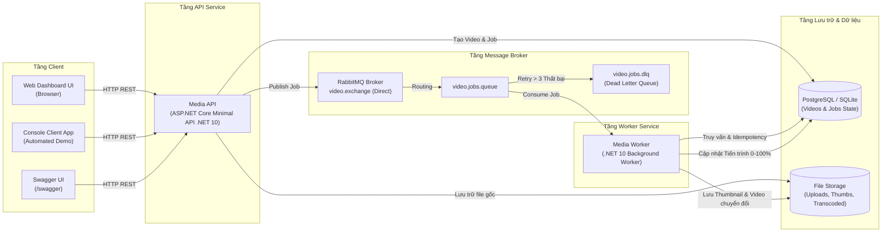

# Đề tài 14: Hệ thống Xử lý Video Bất đồng bộ (Distributed Asynchronous Video Processing System)

Học phần: **Phát triển ứng dụng phân tán**  
Nền tảng: **.NET 10** | Ngôn ngữ: **C#** | Message Broker: **RabbitMQ** | Database: **PostgreSQL / SQLite**

---

## 1. Giới thiệu đề tài

Trong các hệ thống phân tán hiện đại, các tác vụ xử lý phương tiện truyền thông (video encoding, trích xuất metadata, tạo ảnh thu nhỏ thumbnail, chuyển đổi định dạng chất lượng) thường tiêu tốn nhiều tài nguyên CPU, bộ nhớ và thời gian. Nếu xử lý đồng bộ (synchronous) trong cùng một tiến trình API request, Client sẽ bị nghẽn (blocking), dẫn đến tình trạng timeout và suy giảm năng lực phục vụ của hệ thống.

Hệ thống xử lý video bất đồng bộ giải quyết triệt để vấn đề này bằng cách:
* **Tách rời (Decoupling):** Tiếp nhận yêu cầu tải lên và khởi tạo job qua **Media API** cực nhanh, trả về phản hồi ngay lập tức cho Client.
* **Hàng đợi thông điệp (Message Queue):** Đưa tác vụ vào **RabbitMQ** để đảm bảo không mất mát dữ liệu và phân phối đều cho các Worker.
* **Xử lý nền (Background Processing):** **Media Worker** độc lập tiếp nhận job từ queue, xử lý tính toán nặng và cập nhật tiến trình vào Database cùng File Storage.

---

## 2. Kiến trúc hệ thống

### 2.1 Sơ đồ kiến trúc tổng thể



### 2.2 Các thành phần chính

| Thành phần | Công nghệ | Nhiệm vụ chính |
| :--- | :--- | :--- |
| **MediaApi** | ASP.NET Core Minimal API (.NET 10) | Cung cấp RESTful endpoints, tiếp nhận video upload, tạo job, publish message vào RabbitMQ, phục vụ Web Dashboard & Swagger UI. |
| **RabbitMQ** | RabbitMQ 3.x Alpine | Điều phối phân phối thông điệp bất đồng bộ, quản lý hàng đợi chính (`video.jobs.queue`) và Dead-Letter Queue (`video.jobs.dlq`). |
| **MediaWorker** | .NET 10 Worker Service | Tiêu thụ message từ queue, kiểm tra idempotency, thực hiện trích xuất metadata, sinh thumbnail SVG/ảnh, transcode video (480p, 720p, 1080p). |
| **PostgreSQL / SQLite** | EF Core 9 / Npgsql | Quản lý trạng thái thực thể `Video` và `VideoJob`, lưu vết CorrelationId, lịch sử tiến trình và dữ liệu kết quả JSON. |
| **File Storage** | Shared Volume / Local Storage | Phân vùng lưu trữ tập tin: `uploads/`, `thumbnails/`, `transcoded/`. |
| **Client** | Web App & Console App | Giao diện Web trực quan thời gian thực + Console Client tự động hóa kịch bản kiểm thử. |

---

## 3. Các chức năng chính & Yêu cầu mở rộng

### 3.1 Chức năng chính
1. **Đăng ký hoặc upload một video:** Hỗ trợ upload file thực tế qua `multipart/form-data` hoặc đăng ký video qua JSON.
2. **Tạo job xử lý video:** Hỗ trợ đa dạng tác vụ:
   - `ExtractMetadata`: Trích xuất thông số kỹ thuật (độ phân giải, thời lượng, codec, bitrate).
   - `GenerateThumbnail`: Tạo ảnh đại diện frame tiêu biểu cho video.
   - `Transcode480p`, `Transcode720p`, `Transcode1080p`: Giả lập/chuyển đổi chất lượng đa độ phân giải.
3. **Đưa job vào queue:** Publish persistent message tới exchange `video.exchange` kèm routing key `video.job`.
4. **Worker nhận và thực hiện tác vụ:** Cơ chế Fair Dispatch (`BasicQos prefetchCount=1`) để phân tải đều khi mở rộng nhiều Worker instance.
5. **Cập nhật tiến trình:** Worker cập nhật tiến độ liên tục (10% -> 35% -> 60% -> 85% -> 100%) vào Database.
6. **Lưu trữ kết quả:** File kết quả được ghi vào Storage và metadata JSON được cập nhật vào bản ghi Job.
7. **Tra cứu trạng thái job:** API `GET /jobs/{id}` trả về trạng thái, lỗi (nếu có), tiến trình hiện tại.
8. **Tra cứu danh sách video:** API `GET /videos` và `GET /videos/{id}` hiển thị toàn bộ thông tin video và danh sách các job trực thuộc.

### 3.2 Yêu cầu mở rộng (Bonus Features)
- **Retry & Dead-Letter Queue (DLQ):** Khi worker xử lý lỗi, message được retry tối đa 3 lần. Nếu vẫn thất bại, message tự động được định tuyến sang `video.jobs.dlq` trên exchange `video.exchange.dlq` để audit, không gây nghẽn queue chính.
- **Idempotent Consumer:** Trước khi xử lý, Worker kiểm tra trạng thái trong Database. Nếu job đã `Completed` hoặc `Failed`, worker gửi Ack và bỏ qua việc xử lý trùng lặp.
- **Correlation ID:** Mã định danh tương quan `X-Correlation-ID` được sinh từ Client/API và lan truyền qua RabbitMQ message và log của Worker giúp truy vết xuyên suốt luồng phân tán.
- **Health Check:** Endpoint `/healthz` kiểm tra tính sẵn sàng của cả cơ sở dữ liệu và RabbitMQ broker.
- **Cấu hình độc lập (12-Factor App):** Toàn bộ connection string, host, port được quản trị thông qua biến môi trường.

---

## 4. Danh mục API

| Phương thức | Đường dẫn | Chức năng | Input / Ghi chú |
| :--- | :--- | :--- | :--- |
| `POST` | `/videos` | Tải lên / Đăng ký video mới | Multipart file hoặc JSON `{ "title": "..." }` |
| `POST` | `/videos/{id}/jobs` | Khởi tạo job xử lý video và đưa vào queue | JSON `{ "jobType": 1..5 }` |
| `GET` | `/videos` | Lấy danh sách toàn bộ video | Danh sách kèm URL tải, thumbnail & trạng thái |
| `GET` | `/videos/{id}` | Lấy thông tin chi tiết 1 video | Kèm danh sách các job và kết quả |
| `GET` | `/jobs/{id}` | Tra cứu trạng thái và tiến độ của job | Trả về tiến trình %, kết quả JSON, correlationId |
| `GET` | `/storage/{folder}/{file}` | Tải hoặc stream file media trực tiếp | Hỗ trợ range processing cho video player |
| `GET` | `/healthz` | Kiểm tra tình trạng sức khỏe hệ thống | Trạng thái DB và RabbitMQ |
| `GET` | `/swagger` | Swagger UI tương tác trực tiếp API | Giao diện OpenAPI chuẩn |
| `GET` | `/` | Web Dashboard tương tác trực quan | Giao diện Web Client thân thiện |

### Giá trị JobType:
* `1` = `ExtractMetadata`
* `2` = `GenerateThumbnail`
* `3` = `Transcode480p`
* `4` = `Transcode720p`
* `5` = `Transcode1080p`

---

## 5. Hướng dẫn cài đặt và khởi chạy

### Cách 1: Khởi chạy toàn bộ hệ thống bằng Docker Compose (Khuyên dùng khi nộp bài và chấm thi)

Hệ thống đã cấu hình đầy đủ `Dockerfile` cho từng service và `docker-compose.yml`. Chỉ cần 1 lệnh duy nhất:

```bash
docker compose up --build
```

Sau khi khởi chạy:
* **Web Client Dashboard:** [http://localhost:5000](http://localhost:5000)
* **Swagger API Documentation:** [http://localhost:5000/swagger](http://localhost:5000/swagger)
* **RabbitMQ Management Dashboard:** [http://localhost:15672](http://localhost:15672) *(Tài khoản: `guest` / `guest`)*
* **API Health Check:** [http://localhost:5000/healthz](http://localhost:5000/healthz)

---

### Cách 2: Khởi chạy thủ công từng service trên máy cá nhân (.NET 10 SDK)

Nếu không sử dụng Docker, hệ thống tự động fallback sử dụng SQLite:

#### Bước 1: Khởi chạy RabbitMQ
Đảm bảo RabbitMQ đang chạy trên máy (hoặc chạy container RabbitMQ độc lập):
```bash
docker run -d --name rabbitmq -p 5672:5672 -p 15672:15672 rabbitmq:3-management-alpine
```

#### Bước 2: Khởi chạy MediaApi
```bash
cd src/MediaApi
dotnet run
```
*API sẽ lắng nghe tại `http://localhost:5000` (hoặc cổng cấu hình).*

#### Bước 3: Khởi chạy MediaWorker
Mở một cửa sổ Terminal mới:
```bash
cd src/MediaWorker
dotnet run
```
*Worker sẽ kết nối tới RabbitMQ và sẵn sàng tiêu thụ job.*

#### Bước 4: Chạy Console Client tự động kiểm thử
Mở cửa sổ Terminal thứ ba:
```bash
cd src/MediaClient.Console
dotnet run
```
*Console Client sẽ tự động kết nối API, đăng ký video, kích hoạt đồng loạt 3 tác vụ xử lý (Metadata, Thumbnail, Transcoding), hiển thị thanh tiến trình trực tiếp và in bảng kết quả hoàn tất.*

---

## 6. Chạy kiểm thử tự động (Unit & Integration Tests)

Dự án tích hợp bộ kiểm thử tự động xUnit kiểm tra tính toàn vẹn của mô hình dữ liệu, cơ chế Idempotency, lưu trữ file và serialization thông điệp:

```bash
dotnet test
```

---

## 7. Cấu trúc thư mục mã nguồn

```text
concac/
├── src/
│   ├── MediaProcessing.Shared/          # Thư viện dùng chung
│   │   ├── Models/                      # Thực thể Video, VideoJob, Enums
│   │   ├── Data/                        # EF Core DbContext cấu hình quan hệ
│   │   ├── DTOs/                        # Request/Response Data Transfer Objects
│   │   ├── Messaging/                   # RabbitMQ Publisher, Constants, Message Model
│   │   └── Storage/                     # Service trừu tượng hóa File Storage
│   │
│   ├── MediaApi/                        # ASP.NET Core Minimal API (.NET 10)
│   │   ├── Program.cs                   # Định nghĩa các endpoints, DI & Middleware
│   │   ├── wwwroot/                     # Web Dashboard UI (HTML5, Bootstrap, JS)
│   │   ├── appsettings.json             # Cấu hình môi trường
│   │   └── Dockerfile                   # Multi-stage Dockerfile cho API
│   │
│   ├── MediaWorker/                     # Background Worker Service (.NET 10)
│   │   ├── MediaJobConsumer.cs          # RabbitMQ Consumer, Idempotency & Job Executors
│   │   ├── Program.cs                   # Cấu hình Host, Resilience & DI
│   │   └── Dockerfile                   # Multi-stage Dockerfile cho Worker
│   │
│   └── MediaClient.Console/             # Console Client App (.NET 10)
│       ├── Program.cs                   # Kịch bản demo kiểm thử tự động
│       └── Dockerfile                   # Dockerfile cho Client
│
├── tests/
│   └── MediaProcessing.Tests/           # xUnit Unit & Integration Tests
│       └── MediaProcessingTests.cs      # Test cases kiểm thử hệ thống
│
├── docker-compose.yml                   # Điều phối toàn bộ container phân tán
├── MediaProcessingSystem.sln            # Solution file quản lý các project
├── .gitignore                           # Git ignore chuẩn cho .NET
└── README.md                            # Tài liệu hướng dẫn chi tiết
```

---

## 8. Đánh giá hệ thống và khả năng phục hồi lỗi (Fault Tolerance)

1. **Khả năng chịu tải và mở rộng ngang (Horizontal Scaling):**
   - Tầng Worker hoàn toàn stateless đối với session. Có thể dễ dàng scale tăng số lượng worker bằng lệnh:  
     `docker compose up --scale media-worker=3`  
     RabbitMQ sẽ tự động phân bổ cân bằng tải qua cơ chế Round-Robin / Fair Dispatch.
2. **Khả năng tự phục hồi khi gián đoạn kết nối (Resilience):**
   - MediaApi và MediaWorker đều tích hợp thư viện **Polly** với thuật toán Exponential Backoff tự động kết nối lại khi RabbitMQ hoặc PostgreSQL khởi động trễ hoặc tạm dừng.
3. **Bảo toàn dữ liệu thông điệp (Message Durability):**
   - Hàng đợi và exchange được cấu hình `durable: true`.
   - Thuộc tính tin nhắn được cấu hình `Persistent = true`.
   - Cơ chế xác nhận thủ công (`manual Ack`) đảm bảo message chỉ bị xóa khỏi queue khi worker đã xử lý hoàn tất và lưu DB thành công. Nếu worker bị tắt đột ngột giữa chừng, RabbitMQ sẽ tự động hoàn trả message về queue để worker khác xử lý tiếp.
